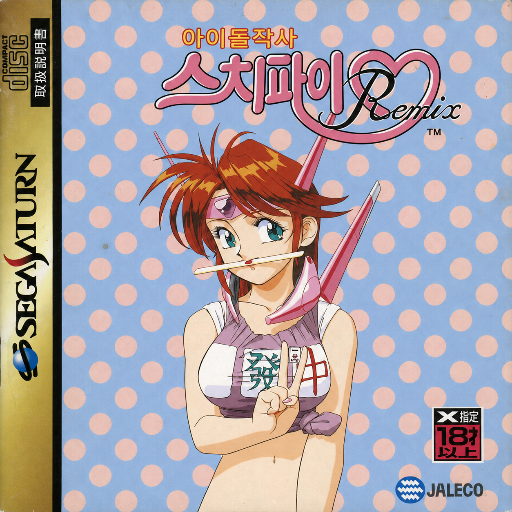

<p align="center"></p>

# 아이돌 작사 스치파이 Remix (Idol Janshi Suchie-Pai Remix) 세가새턴판 한글 패치

쟈레코(Jaleco)가 1995년 9월 29일 세가새턴으로 낸 2인 마작 게임 『아이돌 작사 스치파이 Remix』(T-5704G)의 한글화 저장소입니다. 『스치파이 스페셜』을 다시 손본 판입니다. 같은 시리즈 『스치파이 II』 한글화를 작업 방식의 전례로 삼았지만, 게임 엔진과 파일 형식은 서로 다릅니다.

**원본 디스크 이미지는 들어 있지 않고, 앞으로도 커밋하지 않습니다.** 사용자가 가진 원본에서 한글판을 만드는 방식입니다.

## 현재 상태

개발 중(배포판 없음). 빌드 결과의 `manifest.json`은 `distribution: false`입니다.

- 초기 조사 완료: 대사는 자막 없이 음성으로만 나오고, 화면의 일본어는 모두 그림 글자입니다([`docs/initial-survey.md`](docs/initial-survey.md)).
- 한글 타이틀 로고 적용: 「아이돌작사」·「스치파이♡」(소유자 제작). 「Remix」는 원본 영문 유지. 타이틀 화면과 오프닝 로고 장면에서 확인.
- 오프닝 큰 글자: 흐르는 「아이돌작사」와 번쩍이는 「스·ー·치·ー·파·이」(원본 질감을 따라 생성). 오프닝 전체 진행 확인.
- 메뉴·캐릭터 선택·사운드 테스트·규칙 화면 그림 글자 44개(번역 검수 전).

계획(사람 결정 2026-10-16): v1.0 = 그림 글자 전부(메뉴, 대국 화면, 역 이름, 규칙 표, 프로필 카드, 패널 매치, 오프닝 소개, 스태프 롤), v1.1 = 음성 자막.

## 지원 원본

`Idol Janshi Suchie-Pai Remix (Japan)` — 트랙 1(MODE1/2352, 147,518섹터) SHA-1 `ac800da596c31d478989e9dac309198ddf527143`. CHD는 `chdman extractcd`로 BIN/CUE로 풀어서 씁니다. 트랙 1 해시가 다르면 빌드가 거부합니다.

## 번역 데이터

| 파일 | 내용 |
|---|---|
| [`translation/glossary.json`](translation/glossary.json) | 용어·표기 결정. 2편에서 승인된 결정은 `transferred`(이 게임 적용 확인 대기) |
| [`translation/select.json`](translation/select.json), [`assets/select/layout.json`](assets/select/layout.json) | SELECT.CX 그림 글자 44개(원문·원본 해시·번역·상태)와 배치(지우기 방식, 글자 상자·크기·색 번호) |

번역 상태: `needs_review` → `needs_human_review` → `distribution_eligible`.

## 준비물

- Python 3.11 이상, [Pillow](https://pypi.org/project/Pillow/) 9.4, NumPy, SciPy, pytest (테스트용)
- 나눔스퀘어라운드 ExtraBold (`/usr/share/fonts/truetype/nanum/NanumSquareRoundEB.ttf`, 데비안 `fonts-nanum-extra`)
- 결과 그림의 해시를 빌드가 확인하므로, 글꼴·Pillow 버전이 다르면 빌드가 멈춥니다(데비안 12 기준)

## 사용법

```sh
# 한글판 → out/ko/remix_ko.bin·.cue, manifest.json
python3 tools/khpatch.py build --source "/경로/원본.cue"

# 대조군: 아무것도 바꾸지 않은 빌드 (원본과 바이트 단위로 같아야 함)
python3 tools/khpatch.py build --source "/경로/원본.cue" --out out/control --title original --opening original --select original

# 화면 확인 전 조합을 시험할 때만: --unverified (결과 해시 고정 검사 생략, manifest에 표시)

# 테스트 (원본이 work/disc/remix.cue 또는 REMIX_SOURCE에 있으면 통합 테스트도 실행)
python3 -m pytest -q tests
```

빌드는 원본 트랙 해시와 바꿀 파일의 원본 내용을 확인한 뒤, 모든 변경을 섹터 단위 쓰기 계획으로 등록하고(원본 기대값 확인, 겹침 거부, 최종 차이 감사) 한 번에 적용합니다. 바꾼 섹터의 EDC/ECC는 다시 계산합니다. 파일이 원래 섹터 수를 넘으면 빌드가 실패합니다(옮기기는 아직 지원 안 함).

## 권리

- 원작 게임의 권리는 쟈레코와 각 권리자에게 있습니다. 합법적으로 가진 원본에만 적용하세요.
- 이 저장소에는 원본 디스크 이미지나, 원본에서 뽑아낸 그래픽·음성 덤프를 넣지 않습니다.
- `cover_ko.png`(한글판 표지), `logo_idoljanshi_120x21_ko.png`·`logo_suchiepai_256x87_ko.png`(한글 로고)는 프로젝트 소유자가 만든 이미지이며, 원작 그림과 로고 디자인을 바탕으로 합니다.
